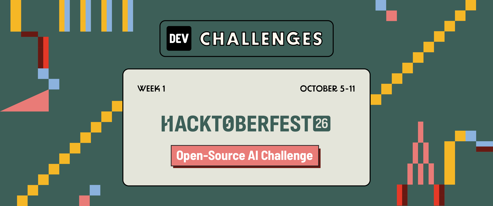
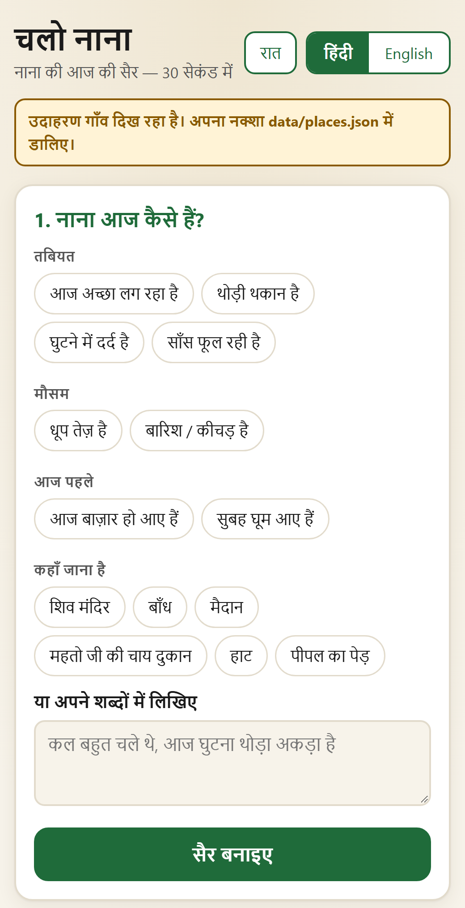
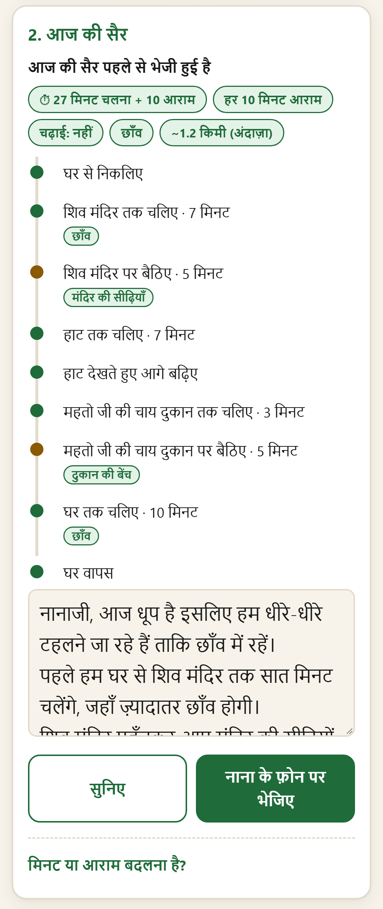
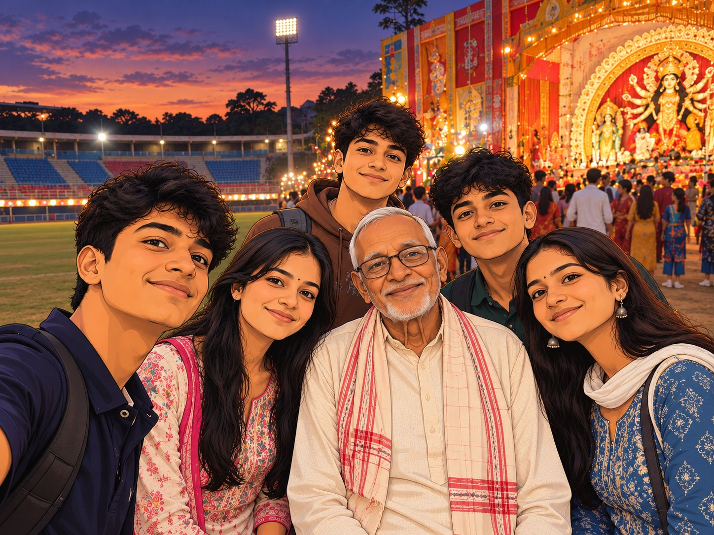
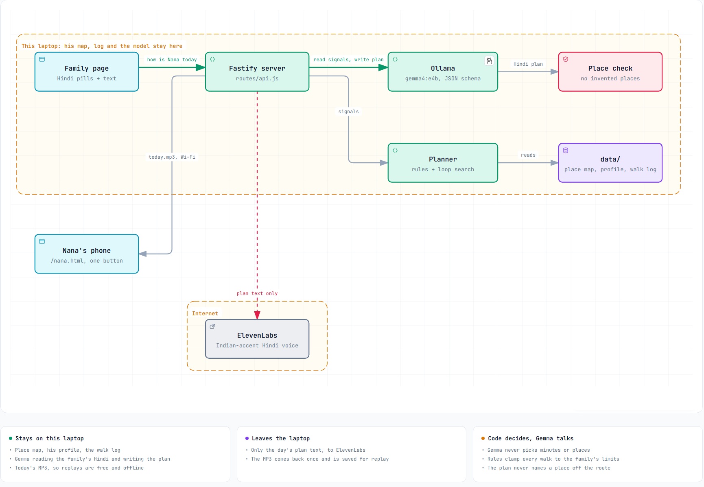

# Chalo Nana · चलो नाना

**A daily walk for my grandfather: planned on a laptop, spoken to him once in Hindi, and then the phone goes in his pocket.**

My Nana's doctor has advised him to walk at least 30 minutes a day. His legs are fine. What he lacks is a reason to put the reels down at five in the evening.

Chalo Nana ("Let's go, Nana") gives him one. Every day a family member spends 30 seconds tapping how he is. A local Gemma model and some plain code turn that into a walk sized for him, through the places he likes, opening with what's happening there today. He hears it once, in a warm Hindi voice, and goes.

Built for DEV's [Hacktoberfest Open-Source AI Challenge, Week 1: Touch Grass](https://dev.to/challenges/hacktoberfest-week1-2026-10-05).

| Family page: 30 seconds a day | Nana's page: one button |
|---|---|
|  |  |



<sub>Screenshots use the made-up example village in `examples/`, never Nana's real map.</sub>

## The first real walk

11 October 2026, the first evening of Navratri. The plan: home, the stadium (sit five minutes), the Durga Puja pandal next to it, back past the stadium, home.

| The pandal | The fifteen extra minutes |
|---|---|
|  |  |

<sub>Our own photos from the walk, cartoonized with AI so no real faces or exact places are online.</sub>

- **Out 6:01 PM, back 7:10 PM**, about 2 km by the map.
- **He heard the plan once and remembered it.** The phone stayed in his pocket the whole walk.
- **He sat twice at the stadium**: five minutes as planned, then fifteen more chatting with the children home from the city for the holidays.
- **What it changed:**
  - His map now says 22 minutes to the stadium, not 20.
  - The "came back tired, go shorter" rule now counts only walking minutes, not time spent chatting.
  - He asked for a more local voice, so it's now an Indian-accent one.
  - The plan now opens with what's happening on the route ("the pandal is ready", "it's haat day"), because the people were the point.

## How it works

<picture>
  <source media="(prefers-color-scheme: dark)" srcset="docs/images/architecture-dark.png">
  
</picture>

<sub>Interactive version: [`docs/architecture.html`](docs/architecture.html) (open locally; source [`docs/architecture.archify.json`](docs/architecture.archify.json), made with archify).</sub>

1. **The family says how he is.** They tap Hindi pills (घुटने में दर्द है, धूप तेज़ है, आज बाज़ार हो आए हैं) plus the places he wants to go, or type a line in their own words.
2. **Gemma reads it.** A local `gemma4:e4b` in Ollama fills a JSON schema of signals: knee `none | mild | strong`, breathless, tired, already walked today, sun, rain, anything serious, places wanted. **It never picks the minutes.**
3. **Rules set the limits.** [`src/planner/settings.js`](src/planner/settings.js) turns the signals into today's minutes, rest interval, uphill and shade, clamped to his profile. A model mistake can't make the walk longer or harder than the family allows. Yesterday counts: after a tiring walk, today is shorter. On a bad day the family page says plainly that the walk is below the doctor's goal, and why.
4. **Code picks the route.** [`src/planner/loops.js`](src/planner/loops.js) enumerates every loop from home back to home and scores each one:
   - It never uses a link marked highway.
   - It wants a seat every N minutes.
   - It prefers places he likes, places asked for today, and places that are lively right now.

   If nothing fits, it says so and offers a short walk to the nearest seat.
5. **Gemma writes what a grandchild would say.** Simple spoken Hindi, Devanagari only, landmarks rather than directions. The speaker is a granddaughter or a grandson (`speaker` in the profile), because Hindi verbs follow the speaker's gender and must match the voice. [`src/planner/describe.js`](src/planner/describe.js) rejects any plan that names a place not on the route: one retry, then a plainer plan written by code.
6. **ElevenLabs says it.** Only the plan text goes out. It becomes one MP3 a day (`eleven_multilingual_v2`, speed 0.9), saved on the laptop, so replays are free and work offline. If ElevenLabs is unreachable, the phone's own Hindi voice reads the text.
7. **After the walk**, the family logs steps, minutes, rests and how he felt. A weekly line shows the doctor's goal against real walks.

### Why a place map, not OpenStreetMap streets

The first plan was to download his neighbourhood from OpenStreetMap and route over its streets. For his village it returned ten road segments, nine of them the highway he should never walk along, plus fourteen ponds. No lanes, no temple, no stadium. So the app doesn't use OpenStreetMap at all.

Villages give directions as places and minutes anyway ("mandir se dam paanch minute"). So that's the map: places, whether he can sit there, when each one is lively, and the minutes between them at his pace, timed on a real walk.

```jsonc
// data/places.json (excerpt; see examples/places.example.json)
{ "id": "pandal", "name": "दुर्गा पूजा पंडाल", "kind": "pandal", "sit": null,
  "hours": [[17, 23]], "likes": 2, "whenOpen": "नवरात्रि शुरू हो गई है और दुर्गा पूजा पंडाल सज गया है" }

{ "a": "stadium", "b": "pandal", "minutes": 2, "highway": false, "uphill": false, "shade": false }
```

## Run it

You need Node 22.9+, [Ollama](https://ollama.com), about 7 GB of disk for the model, and an ElevenLabs API key (text-to-speech permission is enough). It runs on a CPU. On an i7 laptop with no GPU it takes about 9 s to read the Hindi and about 25 s to write the plan.

```bash
ollama pull gemma4:e4b
npm install
cp .env.example .env    # add ELEVENLABS_API_KEY and ELEVENLABS_VOICE_ID; HOST=0.0.0.0 for a phone on the same Wi-Fi
npm start
```

- Family page: `http://localhost:3000`
- Nana's page: `http://<laptop-ip>:3000/nana.html`. The server prints the address at startup.

It starts with the example village. To make it yours:

1. Copy `examples/walker.example.json` to `data/walker.json`. Set the name, how long they can walk, how often they need to sit, the doctor's daily goal, and `speaker` (`granddaughter` or `grandson`, matching the voice in `.env`).
2. Copy `examples/places.example.json` to `data/places.json`. List the places they like, where they can sit, the days or hours each place is lively, and the minutes between places at their pace. Mark any link along a main road `"highway": true`.
3. Check the map without the model: `npm run plan -- 30 10 --slow --no-uphill` prints the best loop for 30 minutes with a rest every 10.

## Privacy

- **Private files:** everything private lives in `data/` and `.env`, both git-ignored. That's the place map, the profile, the walk log, today's audio and the API key. No home coordinates are needed or stored.
- **The model:** Gemma runs on the laptop.
- **What leaves the laptop:** only the day's plan text, sent to ElevenLabs.
- **Nothing else:** no account, no server, no analytics.

## Honest limits

- **Distance:** phone step counters undercount slow walkers. On the first walk his phone counted 1,957 steps for about 2 km. The log keeps steps; distance is best taken from the map.
- **The map's minutes** are family estimates, give or take a few minutes. Update them after each walk.
- **Wi-Fi only:** the phone must be on the same Wi-Fi as the laptop. It's plain HTTP, so there's no GPS; nothing needs it.
- **Speed:** on a CPU, a plan takes about half a minute to make. It's made once a day.

## Project layout

```
src/
  server.js, config.js        Fastify server, settings from .env
  routes/api.js               state, settings, plan, today (+ mp3), walks
  routes/speak.js, pages.js   voice preview, static pages
  planner/settings.js         signals -> today's limits (fixed rules)
  planner/loops.js            loop search and scoring over the place map
  planner/describe.js         route -> steps, code-written Hindi plan, invented-place check
  prompts/settings.js         Gemma prompt + schema: read the family's Hindi
  prompts/speech.js           Gemma prompt + schema: write the spoken plan
  services/                   ollama, elevenlabs, store (data/ files)
public/                       family page (index.html) and Nana's page (nana.html)
examples/                     example village and profile
scripts/plan-cli.js           the planner without the model, to check a map
```

## Stack

Node 22, Fastify 5, plain HTML/CSS/JS with no build step, Ollama with `gemma4:e4b`, ElevenLabs `eleven_multilingual_v2`. One runtime dependency.

## License

MIT
