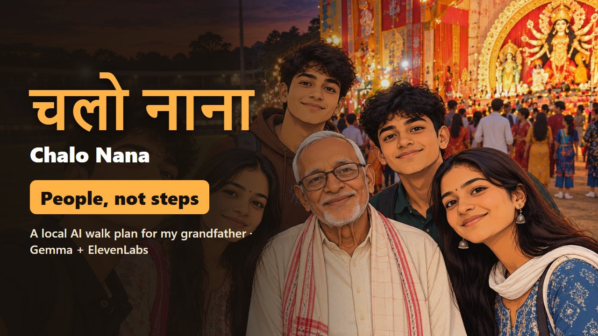

# चलो नाना · Chalo Nana

*Chalo Nana* is Hindi for **"Let's go, Nana"**.

**Tap how Grandpa is today, and get a walk sized for him: a loop through the places he likes, spoken to him once in warm Hindi. Then the phone goes in his pocket.** A local [Gemma](https://ollama.com/library/gemma4) model reads the family's Hindi and plain code plans the route, so his map and his walks never leave the laptop.

Built for my grandfather for DEV's [Hacktoberfest Open-Source AI Challenge, Week 1: Touch Grass](https://dev.to/challenges/hacktoberfest-week1-2026-10-05). 📝 **[Read the full story on DEV](https://dev.to/rahullkumr/chalo-nana-a-local-ai-that-sends-my-grandfather-to-people-not-just-steps-35pc)**

[](https://www.youtube.com/watch?v=tpYq5qZAvFU)

▶ **[Watch the 90-second demo video](https://www.youtube.com/watch?v=tpYq5qZAvFU)**

## Features

- **One button for Nana.** He presses it, hears today's plan once, and walks. Nothing else on his screen.
- **30 seconds for the family.** They tap Hindi pills (*घुटने में दर्द है*, *धूप तेज़ है*, *आज बाज़ार हो आए हैं*) and the places he wants to go, or type a line.
- **Sized for today.** Knee pain, strong sun or an earlier trip to the market means a shorter, slower, flatter walk, with a seat every few minutes. It never takes the highway.
- **A reason to go, not just minutes.** The plan opens with what's happening on the route: *"दुर्गा पूजा पंडाल सज गया है"*, *"आज हाट का दिन है"*.
- **Tracks the doctor's goal.** After each walk the family logs steps, minutes and how he felt. Tomorrow's plan adjusts, and a weekly line shows the 30-minutes-a-day goal against real walks.
- **Private and almost free.** Gemma runs on the laptop. Only the day's plan text goes to ElevenLabs, once.

| How is Nana today? | Today's walk | Nana's page |
|---|---|---|
|  |  |  |

<sub>Screenshots use the made-up example village in `examples/`, never Nana's real map.</sub>

## The first real walk

11 October 2026, the first evening of Navratri: home, the stadium, the Durga Puja pandal next to it, and back. **Out 6:01 PM, back 7:10 PM, about 2 km.** He heard the plan once and remembered it, and the phone stayed in his pocket the whole walk. He sat twice at the stadium, once for fifteen minutes with children home from the city for the holidays.

| The pandal | The fifteen extra minutes |
|---|---|
|  |  |

<sub>Our own photos from the walk, cartoonized with AI so no real faces or exact places are online.</sub>

## How it works

<picture>
  <source media="(prefers-color-scheme: dark)" srcset="docs/images/architecture-dark.png">
  
</picture>

**Gemma understands, code decides.** `gemma4:e4b` in Ollama reads the family's Hindi into a JSON schema of signals (knee `none | mild | strong`, tired, already walked today, sun, places wanted). It never picks the minutes. Fixed rules in [`src/planner/settings.js`](src/planner/settings.js) turn those signals into today's limits, clamped to his profile. [`src/planner/loops.js`](src/planner/loops.js) then scores every loop from home back to home over the family's place map. Gemma writes the chosen route as a granddaughter would say it, and [`src/planner/describe.js`](src/planner/describe.js) rejects any plan that names a place not on the route. ElevenLabs (`eleven_multilingual_v2`, speed 0.9) turns it into one MP3 a day, saved on the laptop for free, offline replays. The prompts are in [`src/prompts/`](src/prompts/). There's also an interactive diagram: [`docs/architecture.html`](docs/architecture.html).

**Why a place map, not street maps?** OpenStreetMap knew only the highway near his village. Villages give directions as places and minutes anyway (*"mandir se dam paanch minute"*). So the family writes that down once: places, where he can sit, when each one is lively, and the minutes between them at his pace. See [`examples/places.example.json`](examples/places.example.json).

## Run it

Needs **Node.js 22.9+**, **[Ollama](https://ollama.com/download)**, about 7 GB of disk for the model, and an **ElevenLabs API key** (text-to-speech permission is enough). No GPU needed: tested on an i7-13700H with 16 GB RAM and Intel Iris Xe, about 9 s to read the Hindi and 25 s to write the plan.

```bash
ollama pull gemma4:e4b
git clone https://github.com/Rahullkumr/chalo-nana.git
cd chalo-nana
npm install
cp .env.example .env    # set ELEVENLABS_API_KEY and ELEVENLABS_VOICE_ID
npm start
```

Open **http://127.0.0.1:3000** for the family page. To open Nana's page from a phone on the same Wi-Fi, set `HOST=0.0.0.0` in `.env`. The server then prints the address (`http://<laptop-ip>:3000/nana.html`). Other settings and their defaults are in [`.env.example`](.env.example) and [`src/config.js`](src/config.js).

It starts with the example village. To make it yours:

1. Copy `examples/walker.example.json` to `data/walker.json`. Set how long they can walk, how often they sit, the doctor's daily goal, and `speaker` (`granddaughter` or `grandson`, matching your voice, because Hindi verbs follow the speaker's gender).
2. Copy `examples/places.example.json` to `data/places.json`. List their places and the minutes between them, and mark any link along a main road `"highway": true`.
3. Check the map without the model: `npm run plan -- 30 10 --slow --no-uphill`.

`data/` and `.env` are git-ignored, so the map, the walk log and the key stay on your laptop.

## Limitations

- Phone step counters undercount slow walkers: 1,957 steps on a walk of about 2 km. Take distance from the map.
- The map's minutes are family estimates. Update them after real walks.
- Nana's phone must be on the same Wi-Fi as the laptop.
- Making a plan takes about half a minute on a CPU. It's made once a day.
- Not medical advice. If the family mentions chest pain, dizziness or fever, the page shows a warning to rest today instead, and the family decides.

## Built with

[Gemma 4](https://ollama.com/library/gemma4) · [Ollama](https://ollama.com) · [Fastify](https://fastify.dev) · [ElevenLabs](https://elevenlabs.io) · plain HTML, CSS and JavaScript

## License

[MIT](LICENSE) © 2026 Rahul Kumar
